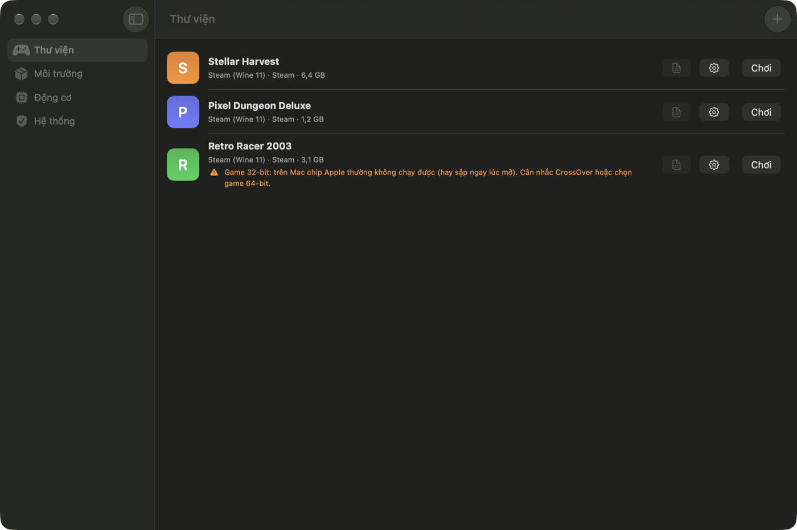
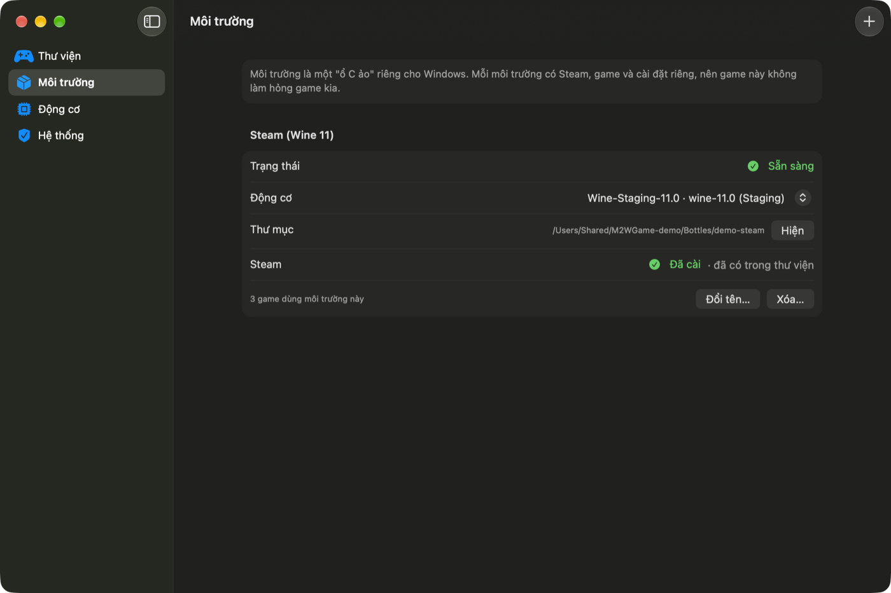
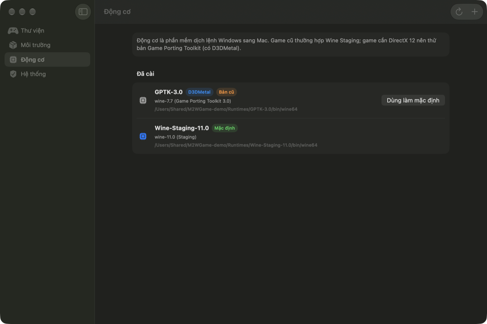
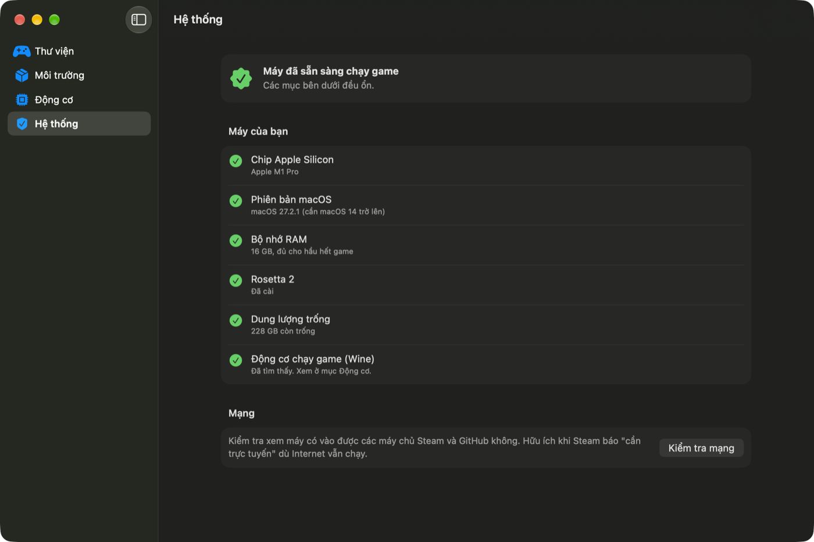

# M2WGame

**English** · [Tiếng Việt](docs/i18n/README.vi.md) · [简体中文](docs/i18n/README.zh-CN.md) · [Español](docs/i18n/README.es.md) · [日本語](docs/i18n/README.ja.md) · [한국어](docs/i18n/README.ko.md) · [Português (BR)](docs/i18n/README.pt-BR.md) · [Français](docs/i18n/README.fr.md) · [Deutsch](docs/i18n/README.de.md)

*M2W = Mac to Windows (games).*

A friendly Mac app that helps you run **Windows games you bought on Steam** on Apple Silicon Macs. It manages Wine
"bottles" (separate Windows environments), Wine engines, Steam for Windows and your game library,
and it explains problems in plain language instead of leaving you with a wall of logs.

> **Status: early alpha.** It works for some games (it was built around getting a 64-bit Unity
> game running at 60 FPS on an M1 Pro) and not for others. Read [Limitations](#limitations)
> before you spend time on a game. The app's interface is currently **Vietnamese only**;
> translations are welcome (see [CONTRIBUTING](CONTRIBUTING.md)). The English README is the
> reference; translated READMEs live in [docs/i18n](docs/i18n) and may lag behind.

> **Scope:** M2WGame focuses on one problem: running **Windows games you bought on Steam**. Other stores and launchers (Epic, GOG, EA, Ubisoft, Battle.net, itch.io…) are not supported yet. You can add a standalone `.exe` by hand, but that path is untested.

M2WGame is **not affiliated with** Apple, Valve, CodeWeavers or the Wine project. It does not
include, download or bypass any game, DRM or licence check: you need to own your games.

## Screenshots

<p>
  
  
</p>
<p>
  
  
</p>

*Library (a 32-bit game gets a warning), environments, engines, system check. The screenshots
use demo data with invented games, and the interface is currently Vietnamese.*

## What it does

- **Library** of games with Play / Stop, per-game settings, game logs and plain-language hints
  about what went wrong.
- **Environments (bottles):** create, rename, delete, pick the Wine engine per environment,
  install Steam for Windows with one click.
- **Engines:** detects Wine builds you put in `Runtimes/` (for example the Gcenx builds of
  Wine Staging or the Game Porting Toolkit) and lets you choose the default.
- **Steam, without Steam's window:** Steam's own window is drawn black under Wine on macOS, so
  M2WGame runs it silently. It can
  - add games that are already in the bottle's Steam library in one click,
  - download new games with SteamCMD inside the app (password and Steam Guard code are typed in
    the app and handed straight to SteamCMD, never stored or logged),
  - show Steam's hidden dialogs (EULA, cloud sync questions) inside the app so *you* can answer
    them, using a short-lived debugging port that is opened only when you ask,
  - warn when a game is 32-bit (these often crash on Apple Silicon),
  - uninstall a game to free disk space.
- **System and network check:** Rosetta, macOS version, RAM, disk space, and whether Steam's
  servers are reachable (useful when Steam says it "needs to be online").

## Requirements

- A Mac with Apple Silicon, macOS 14 or newer, [Rosetta 2](https://support.apple.com/en-us/102527).
- Xcode Command Line Tools (`xcode-select --install`) and [Rust](https://rustup.rs) to build.
- At least one Wine engine (see below). M2WGame does not ship one.

## Install

1. Download `M2WGame-<version>-arm64.dmg` from the [Releases page](https://github.com/ryanle1203/m2wgame/releases) (Apple Silicon Macs, macOS 14+).
   Optional: check it with the `.sha256` file next to it (`shasum -a 256 -c M2WGame-<version>-arm64.dmg.sha256`).
2. Open the `.dmg` and drag **M2WGame** onto **Applications**.
3. **First launch:** the app is not notarized by Apple (that needs a paid developer account), so
   macOS may say it "cannot be opened because the developer cannot be verified". Open it anyway:
   right-click (or Control-click) the app, choose **Open**, then **Open** again. Or go to
   *System Settings → Privacy & Security* and click **Open Anyway**. Or run
   `xattr -dr com.apple.quarantine /Applications/M2WGame.app` in Terminal.
4. Add a Wine engine (see [Get an engine](#get-an-engine)); M2WGame does not include one.

Prefer to build it yourself? See below.

## Build and run

```bash
git clone <this repository>
cd m2wgame
./scripts/build-swift.sh          # builds the Rust core, the SwiftUI app and the .app bundle
open target/M2WGame.app         # inside your cargo target dir
```

Core tests (no Mac UI needed): `cargo test --lib`.

## Get an engine

Put an extracted Wine build under `~/Library/Application Support/M2WGame/Runtimes/` and press
**Rescan** in the Engines tab. Known-good starting points (not bundled, not affiliated):

- Wine Staging for macOS (Wine 11+): <https://github.com/Gcenx/macOS_Wine_builds>
- Game Porting Toolkit builds: <https://github.com/Gcenx/game-porting-toolkit>
  (Apple's D3DMetal is covered by Apple's own licence: do not redistribute it.)
- For DirectX 11 games on plain Wine you may need DXVK-macOS:
  <https://github.com/Gcenx/DXVK-macOS>

For downloading games with the built-in downloader, install
[SteamCMD](https://developer.valvesoftware.com/wiki/SteamCMD) into
`~/Library/Application Support/M2WGame/SteamCMD/`.

## Limitations

- **32-bit Windows games usually do not run** on free Wine builds on Apple Silicon (they crash at
  start-up). M2WGame detects and warns about them.
- Steam's UI is not usable inside Wine on macOS (black window). M2WGame works around it as
  described above; Steam Big Picture, the Steam store and friends are not available.
- DirectX 12 and anti-cheat games are mostly out of reach.
- Only tested on macOS 27 with an M1 Pro. Reports from other Macs are very welcome.

## How it works

A Rust core (`src/`) does everything that is not a window: engine detection, bottles, launching
and stopping, Steam helpers, diagnostics. A SwiftUI app (`swift/`) draws the interface and talks to
the core through a tiny C interface that exchanges JSON. See
[docs/ARCHITECTURE.md](docs/ARCHITECTURE.md).

## Contributing

Bug reports, compatibility notes and pull requests are welcome. Please read
[CONTRIBUTING.md](CONTRIBUTING.md) first (it includes the project's few hard rules, for example
about passwords and DRM). Security issues: see [SECURITY.md](SECURITY.md).

## License

[MIT](LICENSE). Third-party components and what is deliberately *not* bundled:
[THIRD_PARTY_NOTICES.md](THIRD_PARTY_NOTICES.md).
